# VitaLine Clinic

## 1. Название проекта

**VitaLine Clinic** — информационная система медицинской клиники.

## 2. Краткое описание идеи проекта

Система хранит данные пациентов, расписание врачей, записи на приём и результаты посещений.

## 3. Предметная область

Предметная область проекта — обслуживание пациентов в частной медицинской клинике.

Основные сущности:

- **Пациент** — человек, обращающийся в клинику за медицинской помощью.
- **Врач** — специалист, который ведет прием пациентов.
- **Расписание** — набор временных слотов врача.
- **Запись на прием** — договоренность о посещении врача в конкретное время.
- **Прием** — факт оказания медицинской помощи пациенту.
- **Медицинская карта** — сведения о посещениях, жалобах, диагнозах и рекомендациях.
- **Услуга** — медицинская услуга, оказанная пациенту.
- **Платеж** — информация об оплате услуги.

## 4. Анализ аналогичных решений

| Аналог | Преимущества | Недостатки | Удобство записи | История приемов | Простота внедрения |
| --- | --- | --- | --- | --- | --- |
| YCLIENTS | Развитая онлайн-запись, готовая инфраструктура | Избыточность для небольшой клиники | Высокое | Среднее | Среднее |
| 1С:Медицина | Широкая функциональность, интеграция с учетом | Сложность внедрения и сопровождения | Среднее | Высокое | Низкое |
| Medods | Облачный доступ, готовые медицинские сценарии | Подписка, ограничения кастомизации | Высокое | Высокое | Среднее |
| VitaLine Clinic | Узкая адаптация под учебный MVP и небольшую клинику | Требуется самостоятельная разработка | Высокое | Высокое | Высокое |

## 5. Целесообразность и актуальность

Единое расписание позволяет проверять занятость врачей при записи. Электронная карта сохраняет историю приёмов и результаты лечения пациента.

## 6. Акторы

**Пациент** — записывается на прием, отменяет запись, получает информацию о своих посещениях.

**Администратор** — регистрирует пациентов, управляет расписанием врачей, оформляет и отменяет записи.

**Врач** — проводит прием, смотрит историю пациента, фиксирует жалобы, диагноз и рекомендации.

## 7. Use-Case диаграмма

Диаграмма вариантов использования показывает взаимодействие основных акторов с системой.

Файлы:

- `docs/diagrams/use-case.svg`
- `docs/diagrams/use-case.graphml`

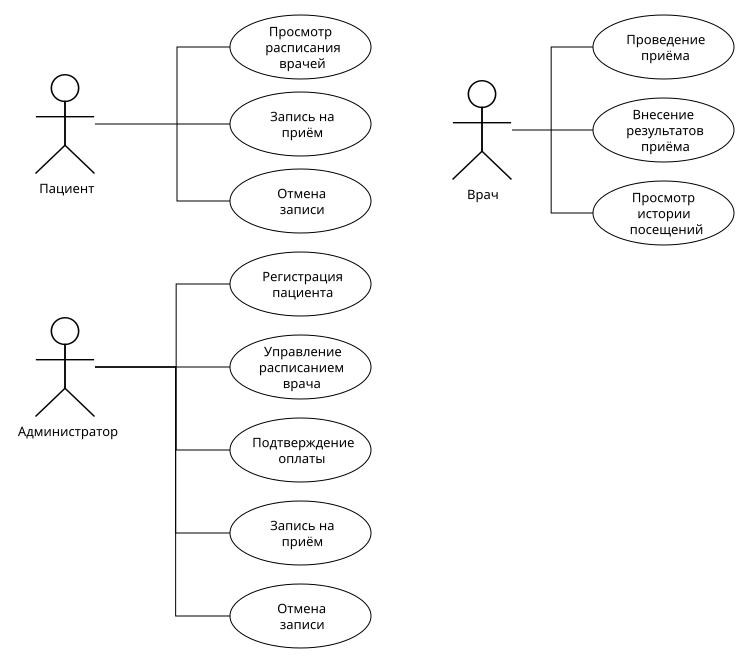

## 8. ER-диаграмма

ER-диаграмма отражает основные сущности предметной области и связи между ними.

Файлы:

- `docs/diagrams/ER.svg`
- `docs/diagrams/ER.graphml`
- `docs/diagrams/DB.drawio`

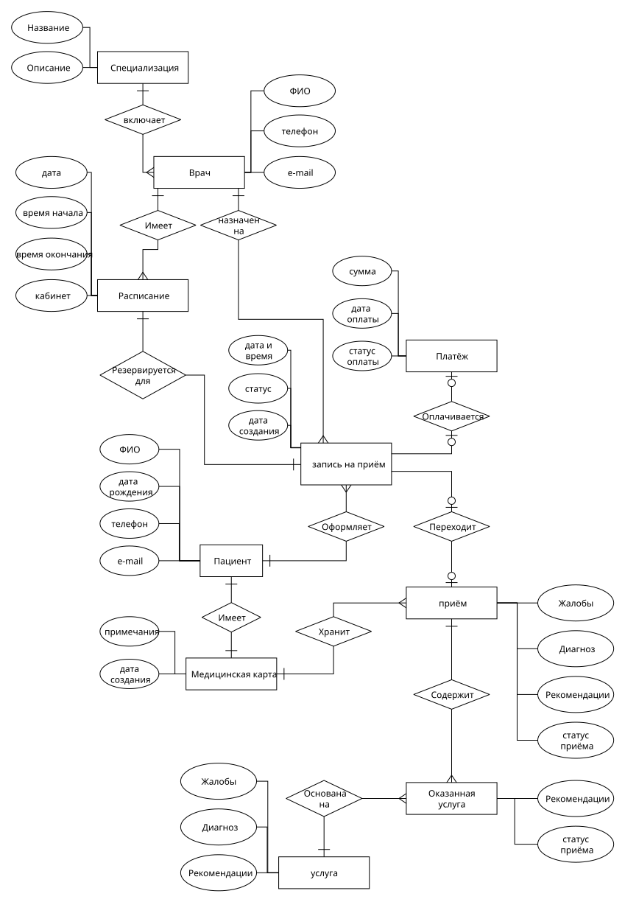

## 9. Пользовательские сценарии

### Сценарий 1. Запись пациента на прием

**Актор:** Администратор.

1. Администратор открывает список пациентов.
2. Если пациента нет в системе, администратор создает карточку пациента.
3. Администратор выбирает врача.
4. Система показывает доступное расписание врача.
5. Администратор выбирает свободное время.
6. Система проверяет доступность слота.
7. Система создает запись на прием.

### Сценарий 2. Проведение приема

**Актор:** Врач.

1. Врач открывает список записей.
2. Врач выбирает пациента, пришедшего на прием.
3. Система показывает данные пациента и историю посещений.
4. Врач фиксирует жалобы пациента.
5. Врач указывает диагноз и рекомендации.
6. Система сохраняет результат приема.

### Сценарий 3. Отмена записи

**Актор:** Пациент или администратор.

1. Пользователь открывает список активных записей.
2. Пользователь выбирает запись.
3. Пользователь инициирует отмену.
4. Система проверяет возможность отмены.
5. Запись получает статус отмененной.
6. Временной слот снова становится доступным.

### Сценарий 4. Управление расписанием врача

**Актор:** Администратор.

1. Администратор выбирает врача.
2. Администратор открывает расписание.
3. Администратор добавляет рабочий слот.
4. Система проверяет корректность времени.
5. Система сохраняет новый слот расписания.

## 10. Формализация бизнес-процессов

Для формализации ключевых бизнес-процессов подготовлены BPMN-диаграммы:

- запись пациента на прием;
- проведение приема врачом;
- отмена записи.

Файлы:

- `docs/diagrams/BPMNAPT.svg`
- `docs/diagrams/BPMNAPT_UML.drawio`
- `docs/diagrams/BPMNVIS.svg`
- `docs/diagrams/BPMNVIS_UML.drawio`
- `docs/diagrams/BPMNVI.svg`
- `docs/diagrams/BPMNVI_UML.drawio`

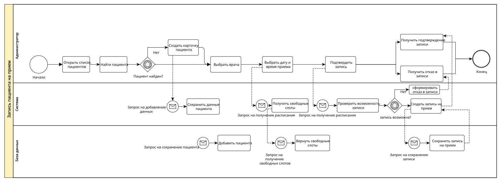

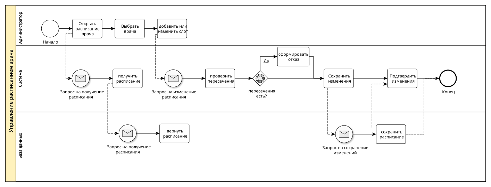

## 11. Тип приложения и технологический стек

Проект развивается как небольшое веб-приложение для медицинской клиники.

На текущем этапе система проектируется с учетом трех пользовательских входов:

- **технический UI** — консольная утилита для администратора и проверки бизнес-сценариев;
- **будущий GUI** — графический интерфейс для работы с пациентами, расписанием и приемами;
- **HTTP API** — слой связи между пользовательским интерфейсом и бизнес-логикой.

Основной сценарий взаимодействия пользователя с приложением:

1. Администратор открывает интерфейс клиники.
2. Система получает данные через HTTP API.
3. API передает запрос в бизнес-логику.
4. Бизнес-логика проверяет правила предметной области.
5. Компонент доступа к данным читает или сохраняет информацию в БД.
6. Результат возвращается пользователю в интерфейс.

Такой стек выбран, потому что он позволяет независимо развивать UI, бизнес-логику и компонент доступа к данным.

## 12. Диаграммы C4

### L1. System Context

Диаграмма показывает систему VitaLine Clinic и внешних пользователей: администратора, врача и пациента.

Файлы:

- `docs/diagrams/L1.png`
- `docs/diagrams/L1.drawio`

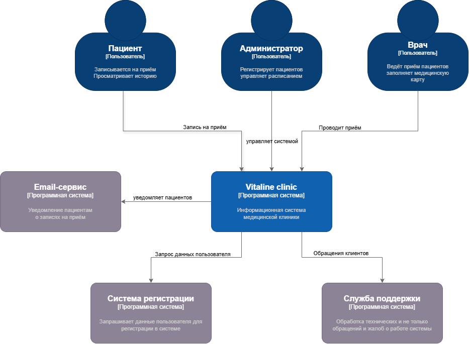

### L2. Container

На уровне контейнеров система разделена на пользовательский интерфейс, backend/API и базу данных.

Файлы:

- `docs/diagrams/L2.png`
- `docs/diagrams/L2.drawio`

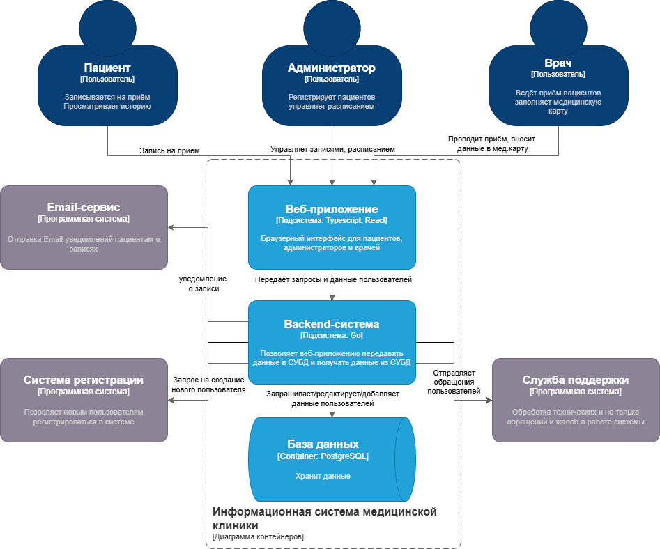

### L3. Component

На уровне компонентов backend разделен на delivery-слой, use-case слой, доменную модель и репозитории.

Файлы:

- `docs/diagrams/L3.drawio.png`
- `docs/diagrams/L3.drawio`

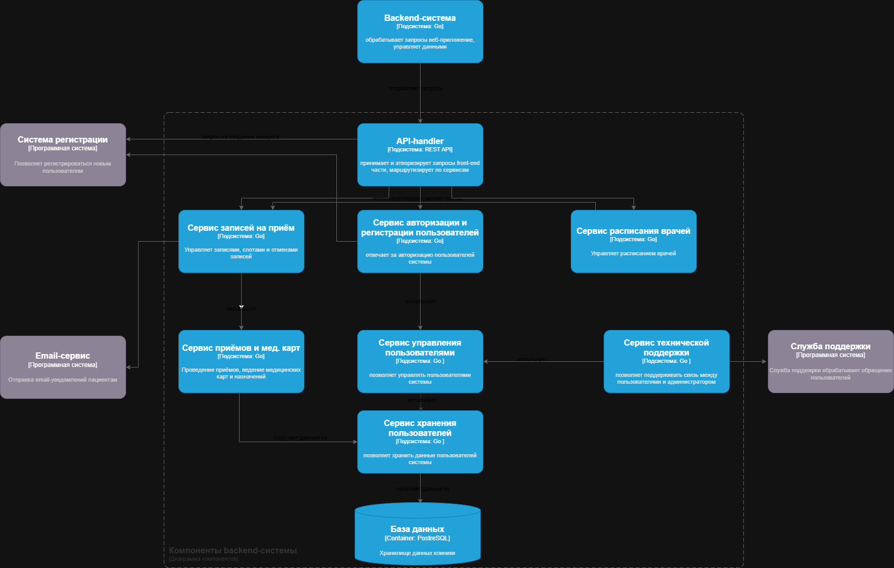

### L4. Code

Для уровня L4 подготовлены две диаграммы: компонент бизнес-логики и компонент доступа к данным.

Файлы:

- `docs/diagrams/L4_service layer.drawio.png`
- `docs/diagrams/L4_service layer.drawio`
- `docs/diagrams/L4_repository_pattern.drawio.png`
- `docs/diagrams/L4_repository_pattern.drawio`

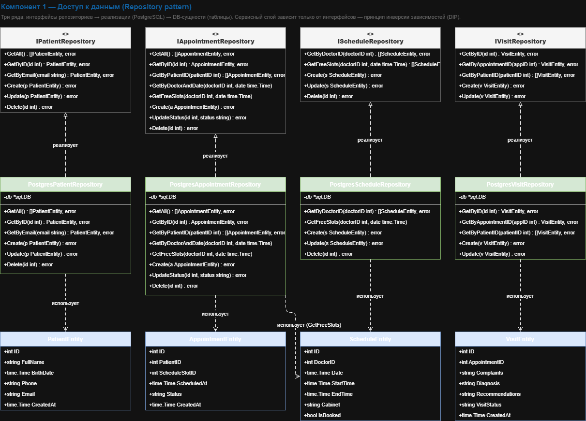

## 13. UML-диаграммы последовательности

Для основных процессов подготовлены UML sequence-диаграммы. Они уточняют шаги, которые ранее были описаны BPMN-диаграммами.

Файлы:

- `docs/diagrams/BPMNAPT_UML.drawio.png`
- `docs/diagrams/BPMNAPT_UML.drawio`
- `docs/diagrams/BPMNVIS_UML.drawio.png`
- `docs/diagrams/BPMNVIS_UML.drawio`
- `docs/diagrams/BPMNVI_UML.drawio.png`
- `docs/diagrams/BPMNVI_UML.drawio`
- `docs/diagrams/sequence_appointment.puml`
- `docs/diagrams/sequence_visit.puml`
- `docs/diagrams/sequence_cancel_appointment.puml`

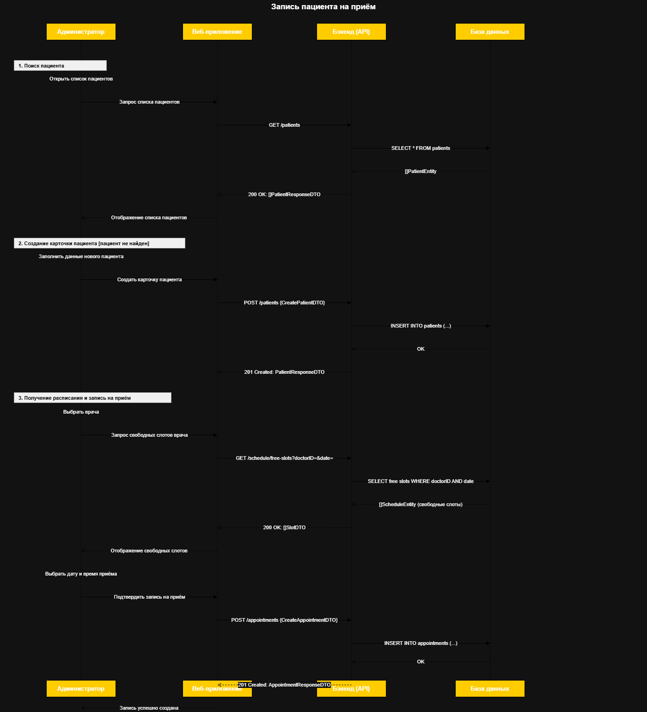

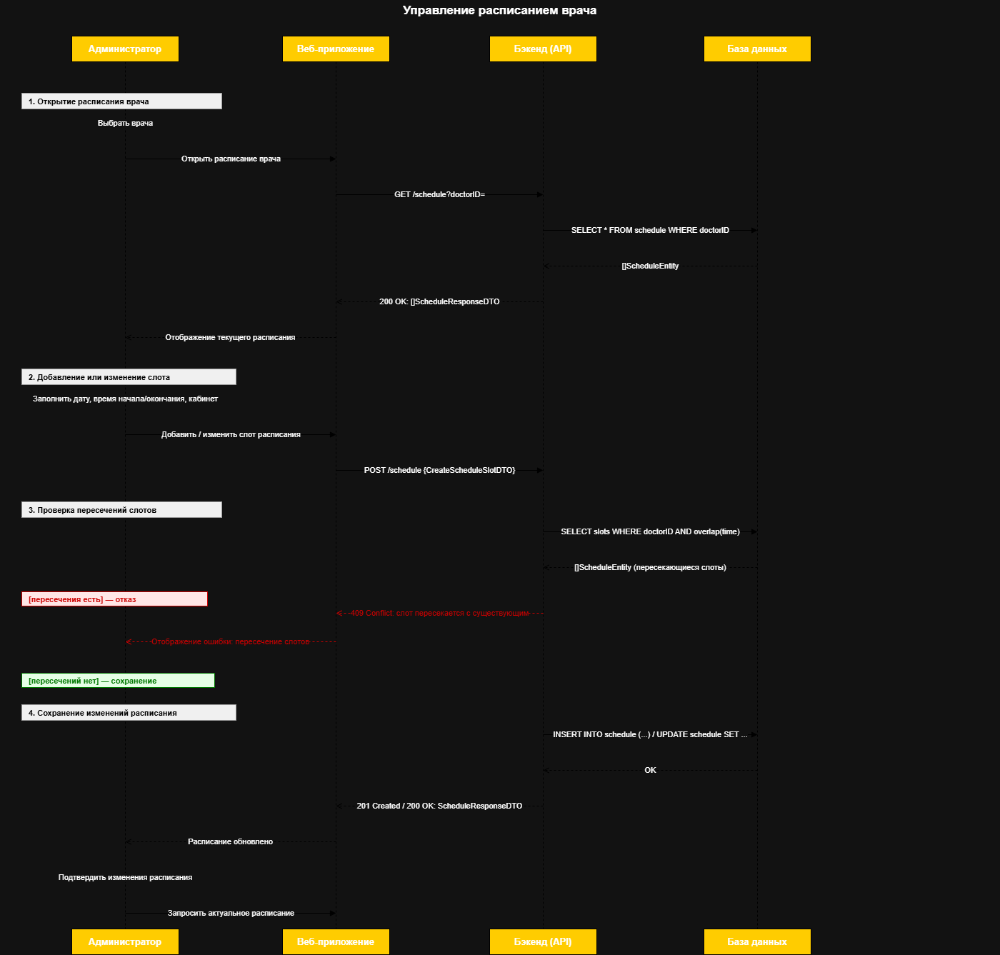

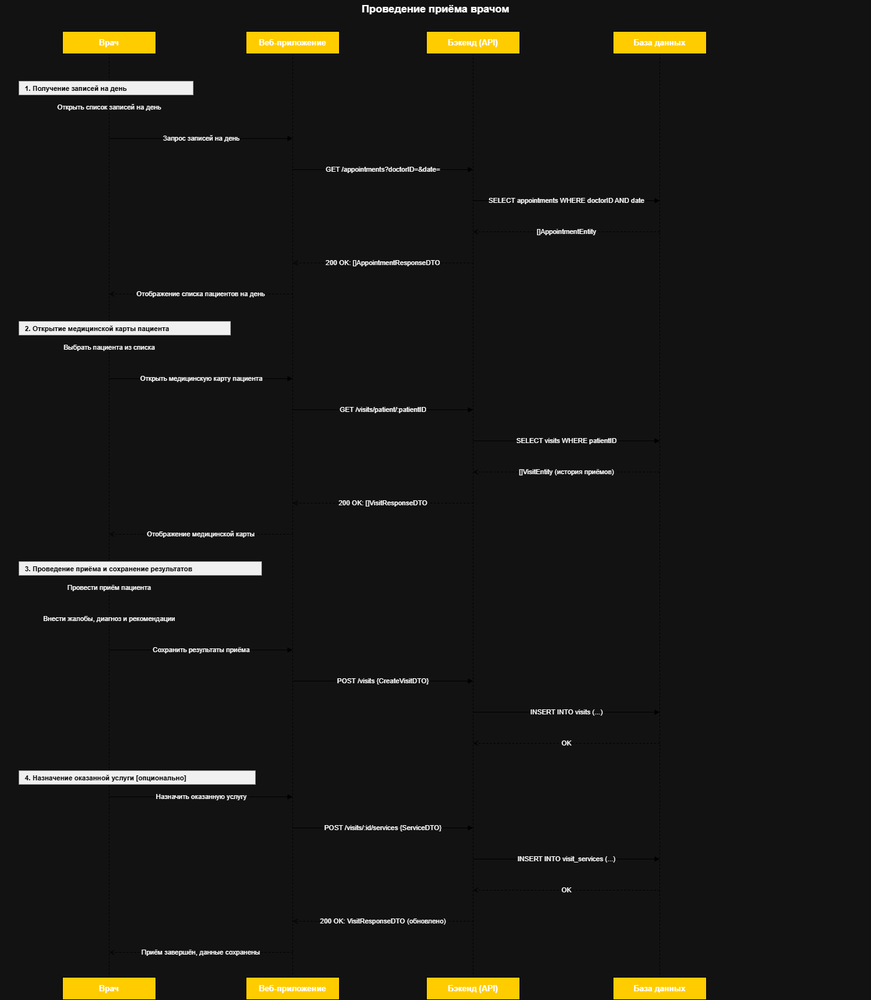

## 14. Диаграмма базы данных

Схема базы данных подготовлена в DBML. Она описывает таблицы пациентов, врачей, расписания, записей, приемов, медицинских карт, услуг и платежей.

Файлы:

- `docs/dbml/vitaline_clinic.dbml`
- `docs/diagrams/DB.drawio`
- `docs/diagrams/ER.svg`

DBML выбран как текстовый формат, потому что его удобно хранить в Git и отслеживать изменения в модели данных.

## 15. Компонент бизнес-логики

В рамках лабораторной работы №3 реализован абстрагированный компонент бизнес-логики. Он не зависит от UI, HTTP, Docker или конкретной базы данных.

Код компонента:

- `VitaLineClinic/internal/domain` — доменные сущности и ошибки предметной области;
- `VitaLineClinic/internal/usecase` — сценарии приложения: пациенты, расписание, записи и приемы;
- `VitaLineClinic/internal/usecase/*_test.go` — модульные тесты публичного API бизнес-логики.

Связь с хранилищем выполнена через интерфейсы:

- `PatientRepository`;
- `ScheduleRepository`;
- `AppointmentRepository`;
- `VisitRepository`.

За счет этого usecase-слой работает с абстракциями, а конкретная реализация доступа к данным может быть добавлена отдельно.

Актуальная L4-диаграмма компонента бизнес-логики:

Модульные тесты проверяют успешные сценарии, валидацию входных данных, ошибки статусов и ошибки репозиториев. Для изоляции бизнес-логики в тестах используются ручные mock-репозитории.

## 16. Компонент доступа к данным

В рамках лабораторной работы №4 реализован компонент доступа к данным для PostgreSQL.

Код компонента:

- `VitaLineClinic/internal/storage/postgres/connection.go` — подключение к PostgreSQL и проверка DSN;
- `VitaLineClinic/internal/storage/postgres/patient.go` — репозиторий пациентов;
- `VitaLineClinic/internal/storage/postgres/appointment.go` — репозиторий записей на прием;
- `VitaLineClinic/internal/storage/postgres/schedule.go` — репозиторий расписания;
- `VitaLineClinic/internal/storage/postgres/visit.go` — репозиторий приемов;
- `VitaLineClinic/internal/storage/postgres/helpers.go` — общая обработка ошибок, сканирование строк и вспомогательные функции;
- `VitaLineClinic/migrations/schema.sql` — SQL-схема БД.

Компонент реализует интерфейсы, объявленные в usecase-слое:

- `PatientRepository`;
- `ScheduleRepository`;
- `AppointmentRepository`;
- `VisitRepository`.

За счет этого бизнес-логика зависит не от PostgreSQL напрямую, а от абстракций. Конкретная реализация хранилища подключается снаружи.

В репозиториях есть обработка основных ошибок:

- пустая строка подключения возвращает validation error;
- отсутствие строки в БД преобразуется в `domain.ErrNotFound`;
- ошибки SQL-запросов оборачиваются с контекстом операции;
- операции update/delete проверяют количество затронутых строк.

Для компонента доступа к данным подготовлены интеграционные тесты:

- сохранение и чтение данных;
- обновление сущностей;
- удаление сущностей;
- проверка поиска свободных слотов и занятости записи.

Интеграционные тесты запускаются при наличии переменной окружения `TEST_DATABASE_URL` или `DATABASE_URL`. Если строка подключения не задана, тесты пропускаются.

Актуальная L4-диаграмма компонента доступа к данным:

## 17. Технологический UI

В рамках лабораторной работы №5 реализован технический пользовательский интерфейс. Это консольное приложение, которое позволяет вручную прогнать основные use-case без графического интерфейса.

Код компонента:

- `VitaLineClinic/cmd/clinic/main.go` — единая точка запуска технического UI;
- `VitaLineClinic/internal/delivery/cli/cli.go` — меню, ввод данных и вывод результатов;
- `VitaLineClinic/internal/storage/memory` — in-memory репозитории для запуска без внешней БД;
- `VitaLineClinic/internal/delivery/cli/cli_system_test.go` — системный тест технического UI.

Технический UI работает через usecase-интерфейсы и не обращается напрямую к доменным сущностям хранения. Поэтому UI можно заменить на GUI, не переписывая бизнес-логику.

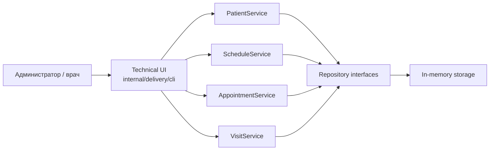

Покрытые сценарии:

- регистрация, поиск, просмотр и удаление пациента;
- создание, просмотр и удаление слотов расписания;
- создание, отмена и просмотр записей на прием;
- начало, завершение и просмотр приема.

Системный тест запускает технический UI со scripted input и проверяет прохождение основных бизнес-сценариев через консольное меню.
